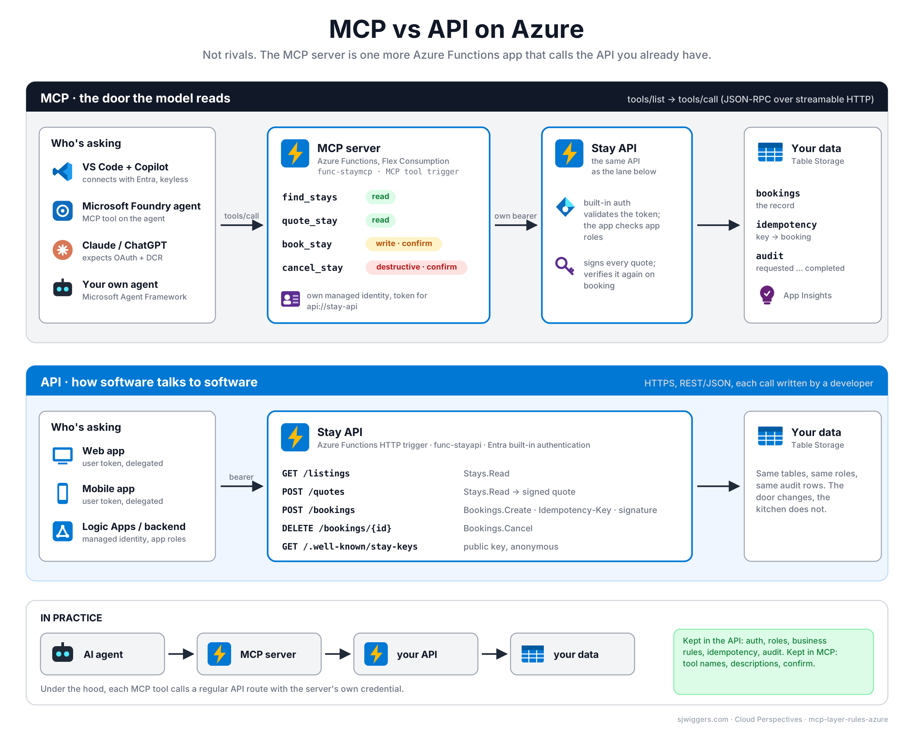
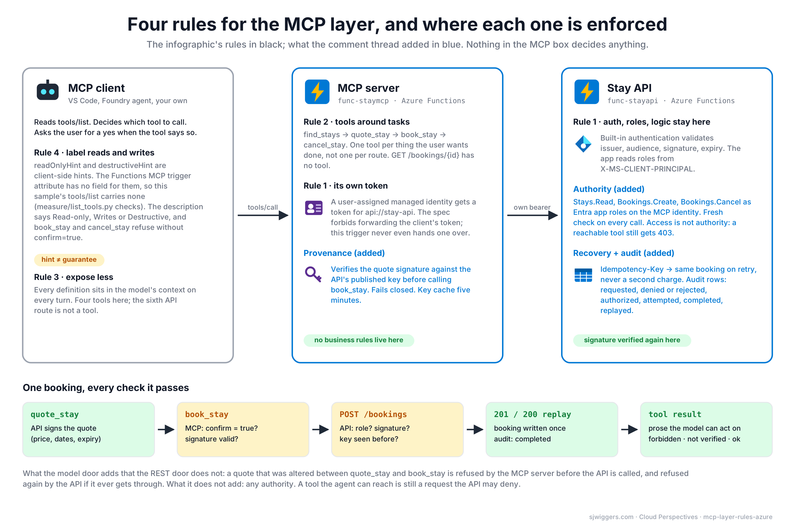

# mcp-layer-rules-azure

Companion sample for the Cloud Perspectives post **"Access Is Not Authority: Four Rules for the MCP Layer, on Azure Functions"** (sjwiggers.com).

A LinkedIn infographic said: you don't pick MCP or an API, you stack them (`AI agent → MCP server → your API`), and gave four rules for the MCP layer. The comment thread added three more concerns: provenance (is the thing the agent acts on genuine), execution authority (access is not authority) and a defined recovery path. This repo puts all seven into two Azure Functions apps and measures the ones that can be measured.

| Door | App | Trigger | Identity |
|---|---|---|---|
| The model reads it | `src/StayMcp` | MCP tool trigger (`Microsoft.Azure.Functions.Worker.Extensions.Mcp` 1.6.0) | user-assigned managed identity, gets its own token for the API |
| Software calls it | `src/StayApi` | HTTP trigger behind Functions built-in authentication (Entra ID) | app roles `Stays.Read`, `Bookings.Create`, `Bookings.Cancel` |

Both are .NET 8 isolated on Flex Consumption. Domain: short-stay bookings (find, quote, book, cancel), chosen because the comment that introduced provenance used a vacation rental booking as its example.



## Where each rule lives

| Rule or addition | Where | File |
|---|---|---|
| 1. Auth, permissions and business logic stay in the API; the MCP server gets its own token | MCP app acquires a token with `DefaultAzureCredential` for `api://<stay-api>`; never sees a user token (the tool trigger does not expose one) | `src/StayMcp/Services/ApiTokenProvider.cs` |
| 1. (API side) | Built-in auth validates the bearer; the app reads roles from `X-MS-CLIENT-PRINCIPAL` and checks them per route | `infra/resources.bicep` (`authsettingsV2`), `src/StayApi/Services/CallerResolver.cs` |
| 2. Tools around tasks, not endpoints | 4 tools for 6 routes: `find_stays`, `quote_stay`, `book_stay`, `cancel_stay`; `GET /bookings/{id}` has no tool | `src/StayMcp/Tools/StayTools.cs` |
| 3. Expose less | `measure/list_tools.py` counts the token cost of `tools/list` and fails CI over a budget | `measure/list_tools.py`, `.github/workflows/build.yml` |
| 4. Label reads and writes | **Finding:** the `McpToolTrigger` attribute takes a name and description only; there is no field for `readOnlyHint`/`destructiveHint`, so `tools/list` carries no annotations. The sample keeps the confirmation in the tool contract (`confirm=true`) and, decisively, in the API's role checks | `src/StayMcp/Tools/StayTools.cs`, `measure/list_tools.py` (reports whether annotations came back) |
| Provenance (comment) | API signs every quote (ECDSA P-256), publishes the key at `/.well-known/stay-keys`; MCP server verifies before calling `book_stay`, fails closed, caches the key 5 min; API verifies again | `src/StayApi/Services/QuoteSigner.cs`, `src/StayMcp/Services/QuoteVerifier.cs` |
| Authority (comment) | Entra app roles assigned to the MCP identity; fresh check per call; 403 rendered as prose for the model | `scripts/grant-roles.ps1`, `src/StayApi/Functions/Bookings.cs` |
| Recovery + audit (comment) | `Idempotency-Key` header; a retry returns the existing booking (200 + `Idempotent-Replayed: true`); audit rows per stage: requested, denied, rejected, authorized, attempted, completed, replayed | `src/StayApi/Services/BookingStore.cs`, `src/StayApi/Services/AuditLog.cs` |



## Run locally

Prerequisites: .NET 8 SDK, Azure Functions Core Tools 4.0.7030+, Azurite (or `azurite` npm package), Python 3.

```powershell
# terminal 1: the API on :7071 with local roles (no Entra)
copy src\StayApi\local.settings.json.example src\StayApi\local.settings.json
cd src\StayApi
func start

# terminal 2: the MCP server on :7072, calling the API with X-Local-Roles
copy src\StayMcp\local.settings.json.example src\StayMcp\local.settings.json
cd src\StayMcp
func start --port 7072

# terminal 3: walk the REST door, prove tamper refusal, idempotent replay and 403
.\scripts\smoke-test.ps1

# the model door: what tools/list costs and whether annotations are on the wire
python measure\list_tools.py --url http://localhost:7072/runtime/webhooks/mcp
```

Local mode (`AUTH_MODE=local`) replaces the token with an `X-Local-Roles` header. `LOCAL_ROLES` in the MCP app's settings decides what the agent may do; drop `Bookings.Create` and `book_stay` returns forbidden prose while `quote_stay` keeps working.

Connect VS Code with `.vscode/mcp.json` (server `stay-mcp-local`) and ask Copilot for "a place in Amsterdam for four, 5 to 8 December". It should call `find_stays`, then `quote_stay`, show you the total and only call `book_stay` with `confirm=true` after you say yes.

## Deploy to Azure

```powershell
azd auth login
azd init -e mcp-layer-rules          # pick a subscription and region (swedencentral works)
.\scripts\new-signing-key.ps1        # QUOTE_SIGNING_KEY into the azd env
.\scripts\setup-entra.ps1            # app registration + three app roles, STAY_API_APP_CLIENT_ID into the azd env
azd up                               # storage, identities, two Flex Consumption apps, built-in auth on the API
.\scripts\grant-roles.ps1            # Stays.Read + Bookings.Create to the MCP identity (add Bookings.Cancel to allow cancel_stay)
```

Then:

```powershell
# the MCP system key for clients that cannot do OAuth (Inspector, VS Code with x-functions-key)
az functionapp keys list -g (azd env get-value AZURE_RESOURCE_GROUP) -n (azd env get-value STAY_MCP_APP_NAME) --query systemKeys.mcp_extension -o tsv

python measure\list_tools.py --url (azd env get-value STAY_MCP_URL) --key <mcp_extension>
python measure\mcp_smoke.py  --url (azd env get-value STAY_MCP_URL) --key <mcp_extension>   # 7-step walk through the model door

# REST door with a real token (you need an app role too; or test from the MCP side)
.\scripts\smoke-test.ps1 -BaseUrl ((azd env get-value STAY_API_URL) + "/api") -Token (az account get-access-token --resource api://<appId> --query accessToken -o tsv)
```

Verified 2026-10-22 against swedencentral: `measure/mcp_smoke.py` passed 7 of 7 steps through the deployed MCP server (own-token call, signed quote, tampered quote refused by the MCP server, confirm gate, booking created, replay without a second write, cancel refused for lack of `Bookings.Cancel`).

Notes:

- Flex Consumption allows one function app per plan, so the bicep creates `plan-stayapi-*` and `plan-staymcp-*`.
- The MCP extension parses date-looking string arguments into a `DateTimeOffset` before binding; a `string` parameter receives `12/05/2026 00:00:00 +00:00` for `"2026-12-05"`. `quote_stay` normalises back to `yyyy-MM-dd` before calling the API.
- `createdBy` on a booking made through the MCP door is the MCP identity's object id; the end user is not in the chain by design (rule 1).
- Windows PowerShell 5.1 strips double quotes from JSON passed to `az rest --body`; the scripts pass bodies via `@file` for that reason. A helper parameter must not be named `$Args` either (automatic variable).

- Skipping `setup-entra.ps1` deploys the API with `AUTH_MODE=local`, which trusts an `X-Local-Roles` header from anyone. Only do that on a throwaway resource group.
- Managed identity tokens are cached up to 24 hours. After changing roles with `grant-roles.ps1`, restart the MCP app or wait.
- Role assignments to the identities' `principalId` live in `infra/roles.bicep` as a separate module; putting them in a for-loop next to the identity resources fails at deploy time.
- The MCP endpoint itself is protected with the Functions `mcp_extension` system key. For end-user clients that expect OAuth, switch on built-in MCP authentication on the MCP app as well (see the earlier post "What a 401 Means to an MCP Client" in the mcp-vs-api-azure-functions repo). This sample keeps the key so the focus stays on the MCP-to-API hop.

## Layout

```
src/StayApi/        HTTP API: listings, signed quotes, idempotent bookings, audit, role checks
src/StayMcp/        MCP server: four task-shaped tools, own-token client, quote verifier
infra/              bicep: storage, identities, Flex Consumption x2, built-in auth, roles module
scripts/            PowerShell 5.1-safe: signing key, Entra app + roles, role grants, smoke test
measure/            list_tools.py (tools/list token cost, annotations check, task vs endpoint shape); mcp_smoke.py (7-step end-to-end over MCP)
images/             make_diagrams.py and the two diagrams (SVG + PNG); drop official Azure icons in images/icons/
docs/               the blog post draft
```

## Build status

`dotnet build mcp-layer-rules-azure.sln` succeeds with 0 warnings and 0 errors (.NET 8 SDK, 2026-10-22). The GitHub Action runs the same build plus the offline measurement on every push.
